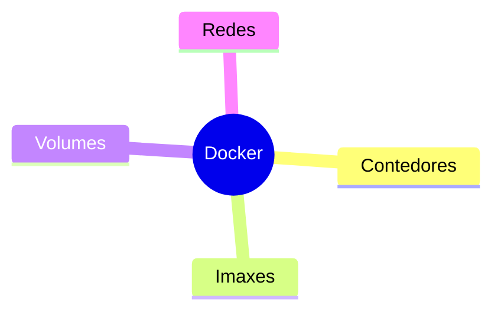
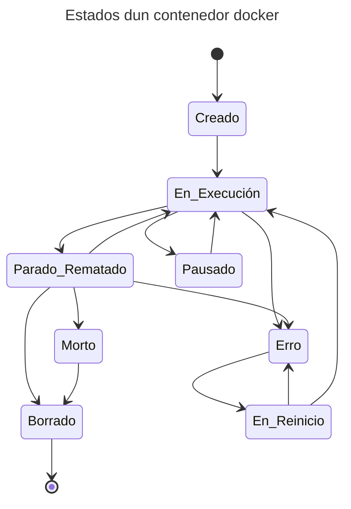

# 🐋 Docker — 🔵 Guía básica


- Baseado en: <https://docs.docker.com/engine/install/debian/>
- Tamén hai dispoñible unha presentación de [🐳 Docker / Contedores](https://jfsanchez.es/docencia/docker){:target="_blank"}

## Instalación de docker en Debian

1. Crear a máquina en AWS / GCloud / Azure / CESGA Cloud ou instalación local en Microsoft Windows con WSL (Debian ou Ubuntu) e conectarse a ela por SSH. De ser unha instancia na nube, trataremos de elexir unha distribución Debian (recoméndase a última estable).

2. Actualizamos ata o final a máquina:
``` bash
sudo apt update
sudo apt -y dist-upgrade
sudo apt -y install curl
```

3. Executamos o script (guión) recomendado pola páxina oficial de docker:
``` bash
curl -fsSL https://get.docker.com -o get-docker.sh
sudo sh ./get-docker.sh
```

4. Engadimos o noso usuario ao grupo docker (para evitar empregar sudo):
``` bash
sudo usermod -a -G docker $USER
```

5. Saímos da sesión e volvemos abrila (ou abrimos unha sesión sobre a actual como se indica a continuación):
``` bash
sudo su - $USER
```

6. Probamos o docker de exemplo de **hola-mundo**:
``` bash
docker run hello-world
```

7. Xa podes probar a instalar o primeiro [docker con MySQL](docker-1-my-maria.md).

Se estás nun contorno **WSL** coa distribución GNU/Debian instalada e recibes o erro:

~~~~ title="/var/log/docker.log"
failed to start daemon: Error initializing network controller: error obtaining controller instance: failed to register "bridge" driver: unable to add return rule in DOCKER-ISOLATION-STAGE-1 chain:  (iptables failed: iptables --wait -A DOCKER-ISOLATION-STAGE-1 -j RETURN: iptables v1.8.9 (nf_tables):  RULE_APPEND failed (No such file or directory): rule in chain DOCKER-ISOLATION-STAGE-1
~~~~

É debido a que docker emprega iptables cunha versión modificada de nftables. Para arranxalo, podemos empregar as legacy iptables:

``` bash
sudo update-alternatives --set iptables /usr/sbin/iptables-legacy
sudo update-alternatives --set ip6tables /usr/sbin/ip6tables-legacy
```

Despois de cambialas, dockerd debería iniciarse correctamente (Fonte: [GitHub](https://github.com/WhitewaterFoundry/Pengwin/issues/485)).

``` bash
sudo service docker restart
```

## Instalación de Docker en Amazon EC2

### Conectar á máquina

Lembra engadir o porto 22 á túa IP no grupo de seguridade.

ssh ec2-user@IP-de-instancia-amazon -i C:\...\chave.pem

### Actualizar
``` bash
sudo dnf update
```

### Instalar Docker, engadir o usuario ao grupo e reiniciar

``` bash
sudo dnf install docker
sudo usermod -a -G docker $USER
sudo reboot
```

### Volver a entrar cando acabe de reiniciar

``` bash
ssh ec2-user@IP-de-instancia-amazon -i C:\...\chave.pem
docker run hello-world
```

## Conceptos básicos de dockers

Podes ver a presentación de: [📦 Docker / Contedores](https://jfsanchez.es/docencia/docker)

⚠️ Este resumo contén imprecisións porque pretende ser breve.


En docker existen os conceptos de: Contedores, imaxes, volumes e redes.

Cando executamos un "docker run", créase un contedor baseado nunha imaxe que se descarga de internet e arráncase. Este contedor é como unha máquina virtual xa configurada e funcionando.

Hai imaxes xa listas en internet: <https://hub.docker.com/> ou ben podemos facer a nosa.

Unha vez creado un contedor podémolo parar ou arrancar.

Podemos gardar os datos en volumes ou directorios compartidos. Se non especificamos nada a información queda no contedor ou no volume que cree por defecto (se o crea).

### Contedores
- Ver contedores en execución: ```docker ps```
- Ver tódolos contedores: ```docker ps -a```
- Crear un contedor: ```docker run hello-world```
    - ```-d```: modo dettached (execución en segundo plano).
    - ```--rm```: borra a instancia cando se para.
- Parar un contedor: ```docker stop [ID ou NOME]```
- Iniciar un contedor: ```docker start [ID ou NOME]```
- Executar un comando dentro do contenedor: ```docker exec -it [ID ou NOME] [COMANDO]```
    - ```-it```: Modo interactivo
- Ver tódalas opcións do contedor: ```docker inspect [ID ou NOME]```
- Borrar un contedor: ```docker rm [ID ou NOME]```

👁️ Se queremos que os contedores volvan executarse cando a máquina se reinicie, cando no momento da creación (run) do contedor podemos especificar a opción: ```--restart unless-stopped```

### Imaxes
- Ver imaxes: ```docker image ls```
- Borrar imaxe: ```docker image rm [ID ou NOME]```

### Volumes
- Ver volume: ```docker volume ls```
- Borrar volume: ```docker volume rm [ID ou NOME]```

# Volumes en cada contedor

Se queremos ver qué volumes están asociados a que contedor:

``` bash
docker ps -a --no-trunc --format "{{.Names}}: {{.Mounts}}"
```

### Recuperando datos dun volume

👁️ Se queremos ver os datos dun volume que xa non está asociado a un contedor, podemos crear un contedor temporal para velos: ```docker run -it --rm -v [ID do volume]:/vol busybox ls -l /vol```

### Asociar un volume previo a un contedor

``` bash
docker run -p 9907:3306 --name contedor_mariadb \
  -v ID_VOLUME:/var/lib/mysql \
  --restart unless-stopped \
  -d mariadb:latest
```

Se `ID_VOLUME` o cambiamos por un directorio, estaríamos a mapear un directorio do anfitrión.

## Estados dun contedor



Realmente existen 6 estados. O estado borrado é para que se vexa mellor no diagrama máis non é un estado. O `Erro` ou `Morto` poden ser o mesmo estado nalgunhas circunstancias.

Máis información acerca dos estados en: <https://www.baeldung.com/ops/docker-container-states>.

## Imaxes oficiales para docker que podes probar

Nesta páxina tes algunhas configuracións rápidas (exemplos xa feitos) baseados nestas imaxes:

- <https://hub.docker.com/_/mysql>
- <https://hub.docker.com/_/mariadb>
- <https://mariadb.com/kb/en/installing-and-using-mariadb-via-docker/>
- <https://hub.docker.com/_/microsoft-mssql-server>
- <https://hub.docker.com/_/mongo>
- <https://hub.docker.com/_/redis>
- <https://hub.docker.com/_/postgres>
- <https://hub.docker.com/_/cassandra>
